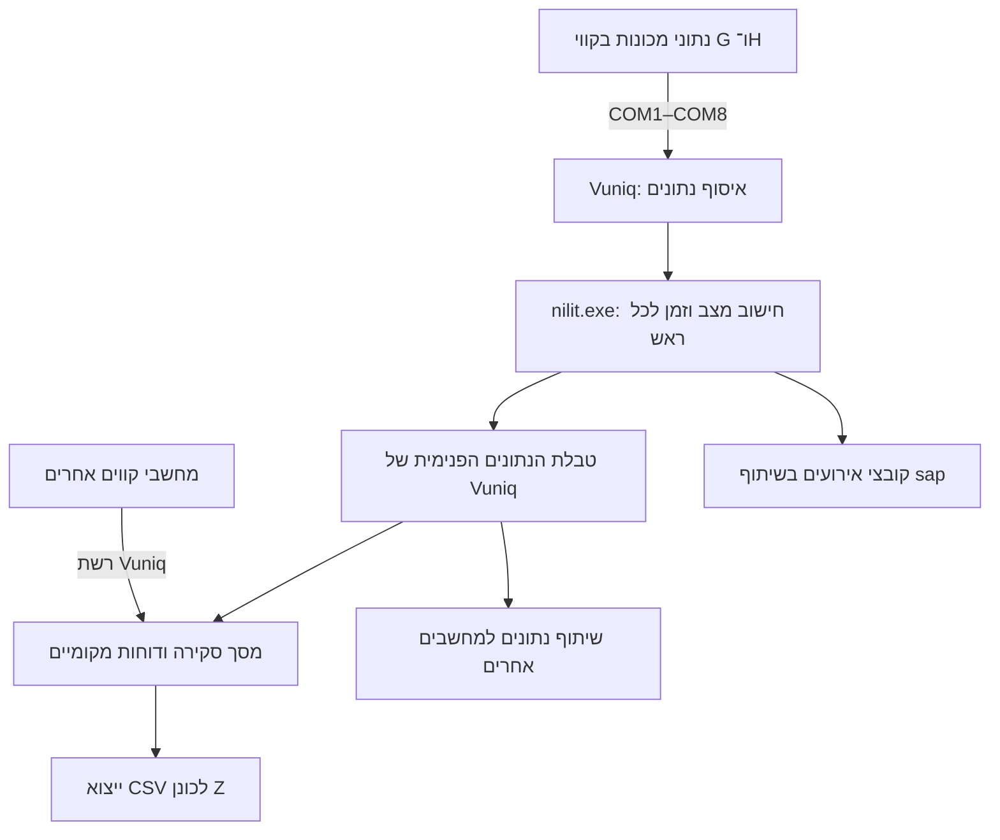

# בקרת קרועים בנילית — פענוח גיבוי Line GH

תאריך הבדיקה: 27.09.2026. מקור: `C:\Users\azeta\Desktop\HMI כללי\Software Backup With D3\Line GH\Vuniq50`.

השוואה נוספת, 27.09.2026: נבדק גם גיבוי Line MN שמסר המשתמש. Vuniq וכל קובצי bin המשותפים זהים ברמת הבתים, אך MN מוגדר דרך OPC ומשתמש בקוד NILIT שונה ל־56 ראשים לפי מהירויות Chuck. הגדרות GH של שמונה חיבורים טוריים אינן חלות על MN. [דוח ההשוואה המלא](C:/Users/azeta/Documents/NILIT/yarn-break-control/comparison-mn-gh/Comparison-MN-GH.he.md).

עדכון מהמשתמש, 27.09.2026: NILIT.EXE אינו מופעל אוטומטית במחשב. הוכנה חבילת Watchdog בתיקייה הסמוכה `watchdog` עבור Windows 7/10, להפעלה בחשבון המפעיל אחרי Vuniq, התאוששות מסגירה ותקיעת חלון, הגבלת הפעלות ויומן. בדיקות לוגיקה ותוכנות דמה עברו; התקנה במחשב היעד, בדיקת Windows 7/10 ופעולה מול תוכנות המפעל עדיין לא בוצעו. זיהוי תקינות חישוב/תקשורת דורש דופק מאומת מתוך NILIT ואינו כלול בבדיקת חלון מגיב.

הבהרת המשתמש בהמשך: באותו מחשב פועלים Vuniq אחד ו־NILIT אחד מול כמה חיבורי RS232. אין דרישה למספר מופעי תוכנה במקביל באותו מחשב. זאת התצורה שלה מיועדת חבילת המשגיח הנוכחית; ניטור בריאות נפרד של כל ערוץ טורי אינו כלול בה.

זהו פרויקט חדש ונפרד מעבודת POLY. הבדיקה מבוססת על קריאת תצורה, קוד מקור, מסך ובסיסי נתונים. לא הופעלו קובצי EXE, לא נוצר חיבור לציוד ולא שונו קובצי המקור. הוראות בתוך הקבצים טופלו כתוכן לבדיקה.

## מה המחשב עושה

המחשב מוגדר לאסוף נתוני מכונות דרך שמונה חיבורים טוריים, לחשב מצבי עבודה ועצירה ל־64 ראשים בקווים G ו־H, להציג אותם לצד קווים אחרים ולשמור היסטוריה. הוא גם משתף נתונים ברשת Vuniq. הלוגיקה העסקית נמצאת בתוכנת VB ייעודית בשם `nilit.exe`, לצד Vuniq.

בקוד שנמצא אין ספירה ישירה של כל קרע בחוט בודד. ההחלטה על מצב הראש מבוססת על מצב הליפוף, נתוני ניקוי וסיבת תחזוקה. לכן אפשר להסביר מכאן ניטור זמינות ועצירות ברמת ראש; אי אפשר להסיק שכל מצב אדום הוא בהכרח אירוע קריעה בודד.

זהו תרשים התצורה והקוד שנמצאו, ולא אימות של התקשורת כיום.

## רכיבי הגיבוי

| רכיב | ממצא ותפקיד |
|---|---|
| `bin\Vuniq.exe` | גרסה 5.9.2.9 לפי מאפייני הקובץ; שם התיקייה Vuniq50 אינו הגרסה המדויקת |
| `barmag\settings.sxml` | שם הפרויקט Nilit_LineG_H; מסך ראשי main.drw; שמונה דוחות פעילים |
| `barmag\vuapp.ini` | הגדרות חיבורים טוריים ורשת |
| `barmag\barmag.ini` | שמות הקווים G/H ונתיבי קובצי האירועים |
| `VB E_L-5` | מקור VB והיישום nilit.exe; מקור מדצמבר 2017 |
| `VB_EtoL-5_old` | גרסה קודמת כמעט זהה; מקור מיולי–נובמבר 2017 |
| `barmag\screens\Main.drw` | מסך סקירה ל־340 עמדות ב־12 קווים |
| `barmag\logs` | דוחות SQLite ויומן מערכת; נתונים שנבדקו מינואר–פברואר 2019 |

הבדלי המקור העיקריים בין שתי גרסאות ה־VB: המתנה של שתי שניות בהתחברות ואתחול מפורש של משתני סיכום. לא הוכח שקובצי EXE תואמים למקורות, ולא זוהה איזה מהם הופעל אוטומטית במחשב המקורי.

## האיסוף המקומי והחישוב

פורטים לוגיים 1–8 מוגדרים פעילים, מקומיים, ללא סימולציה וללא OPC, באמצעות `drvbarmag.dll`, על COM1–COM8 במהירות 9600, שמונה סיביות מידע, זוגיות Even וביט עצירה אחד. תיאור הקובץ של הדרייבר הוא Siemens 3964 Serial Driver; אין בגיבוי תיעוד חיווט או דגם בקר שמאפשר לאמת את החיבור הפיזי.

בקוד קיימים שמונה מקבצים, שמכונים Extruder, ושמונה ראשים בכל מקבץ. מקבצים 1–4 שייכים ל־G ו־5–8 ל־H: 32 ראשים לכל קו. שיוך המקבצים לציוד בשטח טרם אומת.

`nilit.exe` משתמש ב־`Vuniq.VuniqConnector`. בכל הפעלת הטיימר, שמוגדר לשנייה, נסרק מקבץ אחד; סבב מלא נומינלי הוא כשמונה שניות, בתוספת זמני עיבוד. המעבר לרוב המצבים דורש שתי בדיקות, אך תחזוקה מטופלת אחרת. אין להסיק מכך זמן תגובה מדוד.

לכל ראש h בפורט p נקראים:

- מצב ליפוף: `p;1;DW(80+h).0`, לאחר מסכה `And 6`.
- זמן ניקוי: `p;1;S(4+6h)`; יום ניקוי: `p;1;S(5+6h)`.
- סיבת תחזוקה פנימית: `99;1;N(200+10p+h)`.

תוצאות החישוב נכתבות לפורט הפנימי 99: מצב ב־`N(10p+h)`, זמן ב־`N(100+10p+h)` והבהוב ב־`Fp.h`. בנוסף נשלחת בקשת `StatRequest=1` לפורטים של המכונות בערך בכל דקה. לכן התוכנה אינה מבצעת רק קריאות, אף שלא נמצא בקוד שנבדק פיקוד עצירה או התנעה למכונה.

| קוד וצבע | משמעות לפי לוגיקת המקור |
|---|---|
| 1 — ירוק | מצב הליפוף שנבדק אינו אפס: הראש נחשב עובד |
| 2 — אדום | אינו עובד, אין סיבת תחזוקה, ולא התקיים תנאי הניקוי |
| 3 — צהוב | אינו עובד, אין סיבת תחזוקה, והתקיים תנאי הזמן של הניקוי |
| 4 — כחול | אינו עובד וקיימת סיבת תחזוקה |

קוד 5 משמש בקוד לרישום אירוע שינוי מצב ליפוף תוך כדי עבודה; הוא אינו מצב צבע חמישי שמופיע בדוחות שנבדקו.

בכל מעבר מצב נרשמים אירועים ומאופס מונה הזמן. הזמן נשמר כמספר HHMM: למשל 130 פירושו שעה ו־30 דקות. המסך מחלק ב־100 ומציג שתי ספרות אחרי הנקודה, ולכן 1.30 הוא שעה וחצי ולא 1.3 שעות עשרוניות. אלה משכי המצב הנוכחי, לא מוני משמרת. לא נמצאה לוגיקת משמרות במקור הזה.

## המסך והמערכת המבוזרת

| קווים במסך | מספר עמדות | מקור מוגדר |
|---|---:|---|
| A | 24 | פורט 16, מחשב 192.168.66.107 |
| D | 4 | פורט 18, מחשב 192.168.66.109 |
| E / F | 32 / 32 | פורט 11, מחשב 192.168.66.101 |
| G / H | 32 / 32 | פורט 99, הנתונים המקומיים המחושבים |
| I / J | 32 / 32 | פורט 13, מחשב 192.168.66.103 |
| K / L | 32 / 32 | פורט 14, מחשב 192.168.66.104 |
| M / N | 32 / 24 | פורט 17, מחשב 192.168.66.108 |

הפורטים המרוחקים קוראים מטבלת הנתונים הפנימית 99 של תחנות אחרות דרך TCP 1506. פורט 12 לכתובת 192.168.66.102 מוגדר אך אינו פעיל ואינו מקור של עמודה במסך שנבדק.

לכל עמדה יש זמן, צבע מצב ומספר שיכול להבהב; מתחת לכל קו ארבעה סיכומי מצבים. כל 1,069 רשומות ה־Action במסך הן typ=0: לא נמצאה בו פעולת כתיבה, ניווט, סקריפט או הזנת סיבת עצירה.

`screens\Status.INI` מגדיר 0=עבודה, 1=כללי, 2=מתוכננת, 3=שינוי מוצר, 4=חצי שנתי, 5=השבתה. זו רשימת סיבות נפרדת מקודי הצבעים. אין הפניה אליה במסך היחיד שנמצא, ולא זוהה מאיזה ממשק מוזנות סיבות התחזוקה.

שרת Vuniq מוגדר פעיל ב־1506, עם ברירת מחדל ReadWrite. זו הגדרת הרשאות ברשת, לא הוכחה שמישהו מסוים מחובר או כותב. כתובת המחשב המקומי לא נקבעה מן החומר.

## הדוחות, האירועים וההיסטוריה

שמונה דוחות, G_P1–G_P4 ו־H_P1–H_P4, שומרים שמונה זוגות Time/Mode כל אחד, מתוך פורט 99. קצב הדגימה שנמצא הוא חמש דקות. הפלט המקומי הוא SQLite והייצוא מוגדר ל־`Z:\CSV`; ODBC אינו פעיל.

המקורות הם, בהתאמה, N11–N18 עד N81–N88 למצבים ו־N111–N118 עד N181–N188 לזמנים. בסך הכול נמצאו 69,010 רשומות דוח, המכסות בקירוב 11.01.2019 10:55/11:00 עד 10.02.2019 11:05. לא נמצאו ערכי null או כפילויות זמן בתוך הקבצים שנבדקו; בארכיון קיימים מספר פערים. דגימה כל חמש דקות אינה מבטיחה תיעוד של כל עצירה קצרה.

בנפרד מן הדוחות, קוד ה־VB כותב אירועי מעברים ל־`\\192.168.66.100\sap\Log.txt` וגיבויים יומיים ל־`\\192.168.66.100\sap\Backup\`. השם sap מעיד על יעד קבצים מוגדר; אין כאן קוד שמוכיח שהקבצים נקלטים בפועל ב־SAP. הקבצים החיצוניים עצמם אינם בגיבוי שנמסר. קיים גם ייצוא יומן מערכת ל־`Z:\zmani\gh.csv`.

מנגנוני ההתראות הרגילות, הטרנדים והמתכונים של Vuniq כבויים בתצורה; טבלאות ההגדרות הרלוונטיות ריקות. הלוגיקה הייעודית עדיין קיימת ב־VB.

יומן המערכת מתעד ניתוקים וניסיונות חיבור חוזרים למחשבים אחרים, במיוחד ל־.101 ול־.103. הוא גם מתעד 41 כישלונות כתיבת CSV ב־06.02.2019 ועוד 3,296 כישלונות ב־13–16.01.2019. לכן רציפות במסד המקומי אינה מוכיחה שלמות של עותקי ה־CSV. אלה ממצאים היסטוריים בלבד; ספירת הודעות איננה ספירת תקלות עצמאיות.

## פערים שחשובים להמשך

1. זהו גיבוי שהנתונים והתצורה שבו מגיעים לפברואר 2019, גם אם הועתק לאחרונה. דרוש אימות מול המחשב בפועל לפני קביעה שזה המצב הנוכחי.
2. לא נמצאו תצורת ההפעלה האוטומטית של Windows, מיפוי הכונן Z, הגדרות כרטיסי התקשורת או תיעוד הבקרים. זו חבילת יישום, לא תמונת מחשב מלאה.
3. ה־VB קורא תצורה מנתיב קבוע `C:\vuniq50\barmag\barmag.ini`. העתקת התיקייה למקום אחר לבדה אינה משנה את הנתיב הזה.
4. לא ידוע מי מזין את סיבות התחזוקה, ואיזו גרסת nilit.exe הופעלה בפועל.
5. במקור BlinkGreenSP, BlinkRedSP ו־YellowSP מוכרזים אך לא מקבלים ערך, ולכן נשארים אפס. יש לאמת שזו גם התנהגות ה־EXE לפני שמסיקים את זמני ההבהוב והניקוי הרצויים.
6. פונקציית קריאת הנתונים אינה בודקת את קוד ההצלחה או איכות הנתון, וחלק משגיאות הקוד וכתיבת הקבצים נבלעות. מצב או זמן המוצגים במסך אינם לבדם הוכחה לנתון תקין ועדכני.
7. בסריקה יש נקודת כשל אפשרית נוספת: ScanPortNo מתקדם רק בסוף ScanPort. אם חריגה מפסיקה את הפונקציה לפני כן, טיפול השגיאות של Main.Timer1_Timer מפעיל מחדש את הטיימר בלי לקדם פורט. לכן התוכנה עלולה לחזור שוב ושוב לאותו פורט בזמן ששאר הפורטים אינם נסרקים. זו אפשרות בקוד שנבדק, לא תקלה שנצפתה במחשב המפעל.

כיוון שיפור שנבדק: הפרדה בין דופק הטיימר, התקדמות ScanPort לפי פורט, ותקינות תקשורת לכל אקסטרודר. התיעוד המקומי מתאר `100;1;Port1.StCommErr[1]` ועד Port8 כאינדיקציית שגיאת תקשורת, אך משמעות האיכות/החזרה של VuniqConnector.GetItemValue וזמן הדגימה האחרון עדיין מחייבים אימות בגרסה 5.9.2.9. שגיאת RS232 בודדת לא צריכה להפוך אוטומטית לפקודת אתחול כללי. דופק סריקה חדש דורש שינוי ובנייה מחדש של NILIT; הוא לא נוסף לקוד המקור או לחבילת המשגיח בשלב זה.

## עוגני המקור

- `VB E_L-5\General.bas`: שורות 8–18 קודי מצבים וספים; 46–58 גודל המערכת ו־Connector; 65–76 קריאה; 134–160 כתיבת אירועים; 165–184 תנאי ניקוי; 187–331 החלטת מצב; 334–354 מיפוי כתובות; 376–410 שמות קווים וסיכומים; 414–470 המרת זמן וסריקה.
- `VB E_L-5\Main.frm`: טיימר 1000ms, יצירת חיבור והמתנת אתחול.
- `barmag\vuapp.ini`: Networking, Server Security ו־Port1–Port18.
- `barmag\settings.sxml`: שם פרויקט, reports, מקורות עמודות ויעדי CSV.
- `barmag\screens\Main.drw`: מקורות התצוגה, כללי צבע והיעדר פעולות מפעיל; `Status.INI`: רשימת סיבות.
- `barmag\logs\reports\*.db` ו־`archives`: טבלת data; `barmag\logs\system\systemEvents.db` והארכיון: data(stamp,event).

כל האמור על התנהגות מבוסס על הקוד וההגדרות שנמצאו. תאימות ל־EXE, תפקוד בזמן אמת והתאמה לציוד לא נבדקו.
